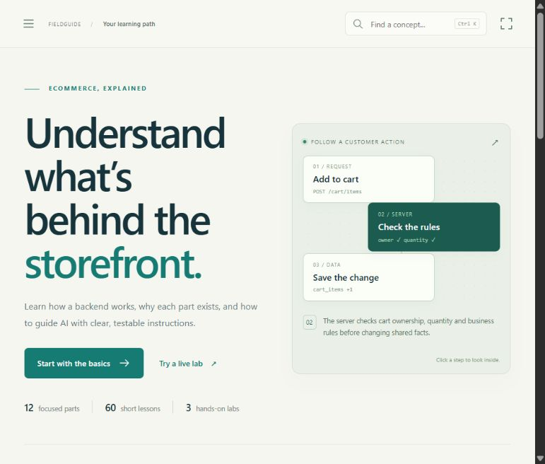

# Backend Fieldguide

An interactive ecommerce backend course by [harshitgupta31415](https://github.com/harshitgupta31415).

Understand what happens behind the storefront, why each backend concept exists, and how to guide AI with precise, verifiable instructions. **12 parts · 60 lessons · 3 games · 3 interactive labs.**



Built for learners who already have a UI/UX direction and want to understand the systems behind it. You can start without memorizing syntax; the aim is to explain data flow, business rules, failure cases, and the evidence that proves a feature works. Teachers can use the same material for guided discussion and demonstrations.

## Run locally

Install Git, **Node.js 20.9.0 or newer**, and npm.

```sh
git clone https://github.com/harshitgupta31415/backend-fieldguide.git
cd backend-fieldguide
npm ci
npm run dev
```

Open [http://127.0.0.1:3000](http://127.0.0.1:3000).

No environment variables, database, API keys, or external accounts are needed. Dependencies require internet access to install. Reference links open external documentation. The server binds to `127.0.0.1`; the repository contains source for running the course locally, with no hosted deployment.

To run a production build on your computer, stop the development server and run:

```sh
npm run build
npm start
```

This also serves the course locally. It does not publish the website.

## A course you can work through

- **A visual learning path:** twelve connected parts, a next-lesson card, progress indicators, and milestones.
- **Four small steps per lesson:** Understand → Explore → Solve → Apply.
- **Interactive explanations:** select diagram nodes, inspect worked examples, and challenge a mistaken assumption.
- **Practice with feedback:** repeat a quiz or game without time pressure, then read why the result makes sense.
- **Progress rewards:** 20 XP per completed lesson and 100 XP for each completed game. Replay games without duplicating rewards.
- **Precise prompts:** edit a topic prompt or build one in the seven-part Prompt workshop.
- **A reference desk:** code-literacy prework, a searchable glossary, and primary documentation.
- **Comfortable navigation:** responsive layouts, keyboard controls, focus mode, and reduced-motion support.

Lesson completion requires solving its prediction question. All parts remain available for exploration; XP and badges show learning progress, not professional certification. Previously saved completion marks remain compatible. Marking a lesson incomplete removes its 20 XP, while keeping its passed quiz check so you can review and complete it again.

## The learning path

Each part contains five lessons. Begin with **Reference desk → Before lesson one** if code is new to you.

| Part | Lessons | Topic | What you learn to explain |
| --- | --- | --- | --- |
| 01 | 01–05 | How backends work | The journey from a customer action to a saved result. |
| 02 | 06–10 | Data foundations | Relationships, constraints, transactions, and safe data changes. |
| 03 | 11–15 | Identity and security | Identity, ownership, sessions, secrets, and sensitive data. |
| 04 | 16–20 | Catalog and cart | Sellable variants, quantities, carts, and trustworthy totals. |
| 05 | 21–25 | Checkout and payments | Payment attempts, verified events, duplicates, and uncertainty. |
| 06 | 26–30 | Orders and fulfillment | Consistent orders, reservations, shipments, returns, and refunds. |
| 07 | 31–35 | Async work and integrations | Background work and reliable communication when systems fail. |
| 08 | 36–40 | Speed and scale | Measured bottlenecks and performance without losing correctness. |
| 09 | 41–45 | Testing and debugging | Evidence, failure cases, integration checks, and observability. |
| 10 | 46–50 | Delivery and operations | Releases, environments, recovery, backups, and monitoring. |
| 11 | 51–55 | Working precisely with AI | Clear specifications, inspection, review, debugging, and verification. |
| 12 | 56–60 | Assemble the complete backend | Connected boundaries, contracts, checkout recovery, and readiness. |

The course teaches the foundations of a standard single-store ecommerce business. Marketplaces, subscriptions, multi-warehouse inventory, disputes, and international money movement need further domain work. Real tax, privacy, delivery, and refund policies must come from the business and appropriate guidance.

## Learn or teach one lesson

1. **Understand:** explain the basic idea and why it exists. Connect it to the store example.
2. **Explore:** activate each diagram node and trace the steps, inputs, rules, and saved result.
3. **Solve:** predict the answer before revealing the teaching explanation. Explain why a plausible alternative fails.
4. **Apply:** customize the topic prompt with actual project context and evidence. Add a takeaway in your own words, then complete the lesson.
5. **Practice:** try a related lab or arcade game. Change one condition and predict the consequence.

For a class, let learners predict independently, compare their reasoning, and then demonstrate the outcome together. Revisit the rule when a learner gets stuck; completing a topic is more useful when they can explain a failure and how to verify it.

### Prompt workshop

Build a prompt from seven ingredients: project context, feature and actor, inputs and outputs, invariants, constraints, failure/concurrency cases, and acceptance evidence. Start with **Expand in the prompt workshop** from a lesson, or load the completed checkout example. Review the compiled text, then copy it or save it as `.txt`.

The ingredient count indicates filled sections, not prompt correctness. Use sanitized examples and keep private keys, passwords, and real customer records out of prompts and notes. The application prepares text; it does not execute prompts or contact an AI service.

## Play and experiment

| Activity | What you do | What it teaches |
| --- | --- | --- |
| Request relay | Put request steps in order across three rounds. | Checks and persistence must happen in a meaningful sequence. |
| Boundary keeper | Sort eight responsibility cards. | The browser, server, provider, and database have different roles. |
| Incident detective game | Inspect evidence and solve three incidents. | Diagnose payment, stock, and ownership problems using the rule and evidence. |
| Inventory lab | Reserve stock, confirm payment, expire unpaid holds, ship, or try the last-unit scenario. | Availability, reservations, and on-hand stock change at different stages. |
| Payment lab | Simulate a timeout, apply success, replay notifications, or reconcile. | Missing information differs from failure; duplicate events must be handled. |
| Request explorer | Change quantity, ownership, method, or a browser-submitted price. | Server checks protect access and determine authoritative amounts. |

Games include feedback, retry/replay controls, and completion rewards. Ordering controls work without dragging. There is no countdown.

All games and labs use synthetic data. This is a learning application, not a working ecommerce backend. It makes no real payment, shipment, or AI API calls. The inventory teaching model deducts physical stock at shipment; payment confirms allocation. The demonstrations are not production implementations of database locking, authentication, or signature verification.

## Saved progress and accessibility

Course state is stored in browser `localStorage` under `backend-fieldguide-v1`: completed lessons, passed quiz IDs, game achievements, notes, the last visited lesson, the Prompt workshop draft, and the reduced-animation setting.

- **Export** in the sidebar downloads `backend-fieldguide-progress.json`.
- **Import** replaces current saved course state with an exported file; it does not merge two learners' records.
- Exports include notes and the workshop draft. Review them before sharing.
- Storage belongs to the browser profile and origin, including hostname and port. There is no account or cloud sync.
- Clearing site data removes the local copy. Keep an export as a portable backup.
- If storage cannot be read or written, a notice prompts you to export before closing the session.

Quiz selections, revealed explanations, active diagram nodes, and unfinished game/lab rounds are temporary. Edits in a lesson's prompt box last while that lesson is open; expand into the workshop to save the draft. Game and lab scenarios restart on remount or refresh, while earned game achievements remain saved.

Use **Tab**, **Enter**, and **Space** to navigate and activate controls. **Ctrl/Cmd + K** focuses lesson search. **Escape** dismisses navigation/search. Use the footer's **Reduce animations** control, or your system's reduced-motion preference. Focus mode gives the lesson more screen space.

## Source map

| Path | Responsibility |
| --- | --- |
| `app/page.js` | Hash navigation, saved state, diagram renderer, labs, prompt workshop, and prework. |
| `app/layout.js` | Root document, metadata, and shared stylesheet imports. |
| `app/globals.css`, `app/experience.css` | Shared layout, lesson design, responsive behavior, and motion. |
| `components/Journey.js`, `app/journey.css` | Learning path, part views, progress, and milestones. |
| `components/LessonExperience.js` | Four-step lesson flow, quiz feedback, notes, prompts, and completion. |
| `components/GameArcade.js`, `app/arcade.css` | Playable backend games and their interface. |
| `lib/game-data.js` | Game routes, responsibility cards, incident evidence, and explanations. |
| `lib/progress.mjs` | Saved-state defaults and validation for current and older progress exports. |
| `lib/lessons.json` | Sixty definitions, examples, exercises, answers, and topic prompts. |
| `lib/interactions.json` | Quiz choices, explanations, and diagram-node details. |
| `lib/reference.json` | Part metadata, glossary, and primary-documentation references. |
| `public/labs.js` | Browser-only inventory, payment, and request simulations. |
| `tests/course.test.mjs` | Automated checks for progress compatibility, import bounds, and lesson content integrity. |
| `package.json`, `package-lock.json` | Start/build commands, Node requirement, and locked dependencies. |

The application uses React and the Next.js App Router. Views use URL hashes inside the client app. Original diagrams are code-native vector graphics. Prework lives in `app/page.js`, not `lib/reference.json`.

## Troubleshooting and contributing

If port 3000 is occupied, stop the other local server or run `npm run dev -- --port 3001`. Use the URL printed by the terminal. Export progress before switching hostname or port because browser storage is origin-specific.

If your production preview shows old content, stop it, run `npm run build`, restart with `npm start`, and reload. Use `npm run dev` while editing. If progress appears missing, check the browser profile and exact URL, then import your saved export.

For a bug report, include the lesson/view, expected behavior, observed behavior, and a small reproduction. For factual corrections, link a primary source. Use synthetic or redacted examples.

Keep contributions focused. Preserve lesson IDs, five lessons per part, and alignment between diagram nodes and `nodeDetails`. Update related examples, quizzes, prompts, and simulations together when a business rule changes.

Before proposing changes, run:

```sh
npm ci
npm test
npm run build
```

Then exercise the affected browser flow. Check keyboard use and a narrow screen for UI changes; reload/export/import for persistence changes; and retries, resets, and invariants for game/lab changes. The automated tests cover progress compatibility, validation, and lesson content integrity; they do not replace browser interaction checks. There is no dedicated lint script. Report checks actually performed rather than treating a successful build as proof of every interaction.
