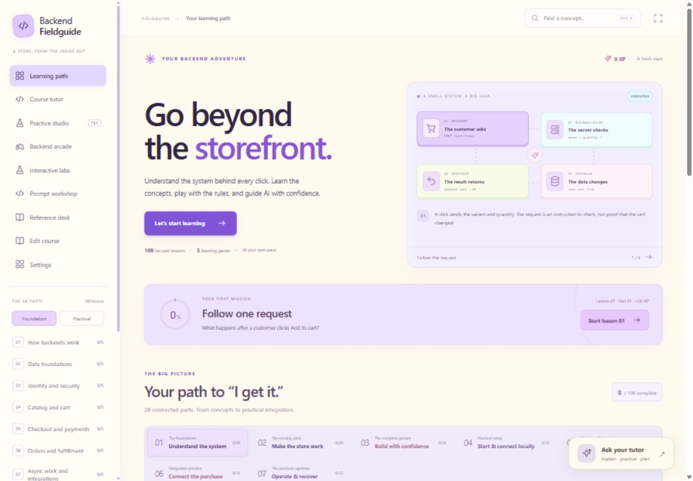
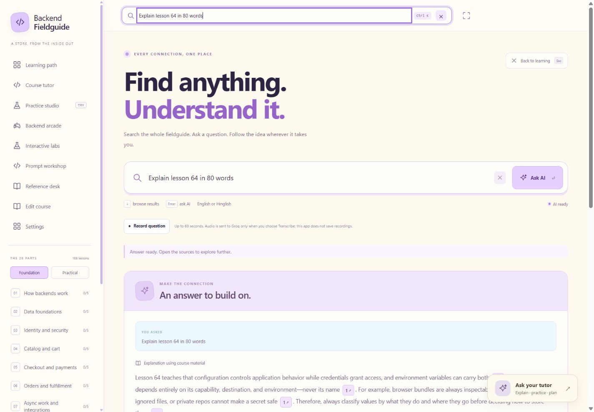
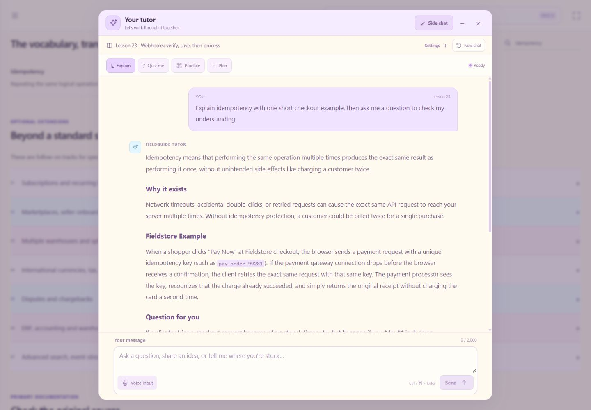

# Backend Fieldguide

An interactive ecommerce backend course by [harshitgupta31415](https://github.com/harshitgupta31415).

Understand what happens behind the storefront, connect the services, investigate failures, and guide AI with precise instructions. **28 parts · 108 lessons · 16 practical missions · 3 games · 3 labs.**



Designed for learners who already understand their intended UI/UX and want to understand the backend well enough to direct, inspect and verify its implementation. You can start without memorizing syntax. The course teaches responsibilities, data, permissions, money, stock, failure recovery and evidence.

The original **60 foundation lessons and their IDs are preserved**. The expansion adds **48 practical lessons**. Seven optional advanced tracks suggest further study beyond the single-store foundation; they are not counted as completed lessons.

[Full curriculum](docs/CURRICULUM.md) · [Fieldstore capstone](docs/CAPSTONE.md) · [Search guide](docs/SEARCH.md) · [AI tutor setup](docs/AI_TUTOR.md) · [Verification record](docs/VERIFICATION.md)

## Run locally

Install Git, npm and a **supported Node.js LTS release that meets the project's Node.js 22.12.0 minimum**. Check the [official release schedule](https://nodejs.org/en/about/previous-releases) when choosing a runtime. Provider exercises must also match the versions installed in the project being inspected.

```sh
git clone https://github.com/harshitgupta31415/backend-fieldguide.git
cd backend-fieldguide
npm ci
npm run dev
```

Open [http://127.0.0.1:3000](http://127.0.0.1:3000).

The **course, games and simulations work without API keys or provider accounts**. The optional AI tutor needs a server-side provider key and internet access. Dependency installation and external reference links also need internet access. The server binds to `127.0.0.1`; this repository is for running the course locally.

To run a production build on your own computer, stop the development server and run:

```sh
npm run build
npm start
```

This starts a local production server. It does not deploy or host the website.

## Search and ask

Use the search bar or **Ctrl/Cmd + K** to find lessons, parts, practice missions, games, labs, glossary definitions, AI prompts, official references and app pages. Search understands common synonyms, simple Hinglish queries and many spelling mistakes. Filter by content type, preview matching passages, copy a prompt, or jump directly to its lesson stage. Your personal lesson additions and edits are included.

Choose **Ask AI** or press **Enter** to request an explanation. Course answers show the retrieved evidence and clickable source links. Questions outside the course receive a clearly labeled general AI answer. **Search does not browse the live web**, and cannot verify current news, prices or documentation. Typing only searches locally; it does not generate paid answers.

Follow up, cancel, retry, dictate a question or listen to an answer. **Ask tutor about this** puts an editable question in the tutor dock. Closing search restores the lesson and its current stage. Queries and search conversations stay in page memory and are not included in progress exports. AI answers use the same optional server-side provider setup as the tutor below. [Read the search guide](docs/SEARCH.md) for details.



## Optional AI tutor

Open the tutor from any page, `#tutor`, or a lesson's **Ask the tutor** link. The desktop chat starts at 600 pixels wide, with an adjustable 480–800 pixel side panel. **Full chat** opens a spacious conversation up to 960 pixels wide; narrow screens use the full viewport. The message box and **Send** stay at the bottom, with lesson settings and **Voice input** tucked into expandable controls. Chat stays while you navigate or minimize it.

Choose **Explain**, **Quiz me**, **Practice** or **Plan**. The server retrieves course excerpts, sends them with your question and relevant learning context to a configured model, and returns an explanation with lesson references. Retrieval uses a local keyword index; no vector database or embedding service is required. Read the cited lessons and verify advice: grounding does not guarantee a correct answer.

1. Copy [`.env.example`](.env.example) to `.env.local` in the project root.
2. Add your own key to `OPENROUTER_API_KEYS`, `GEMINI_API_KEYS`, `GROQ_API_KEYS` or `FREEAI_API_KEYS`. Leave unused providers empty. Each accepts up to six comma-separated keys.
3. Restart the local server, open the tutor and ask a course question.

The default provider order is **OpenRouter → Gemini → Groq → Free.ai**. OpenRouter uses `openrouter/free`, whose available models and limits vary. Other configured providers may consume paid quota or token balances; configure only providers you intend to use. Review [OpenRouter's free router](https://openrouter.ai/docs/guides/routing/routers/free-router), [Gemini pricing](https://ai.google.dev/gemini-api/docs/pricing), [Groq models and pricing](https://console.groq.com/docs/models) and [Free.ai's API plans](https://free.ai/api/).

Automatic failover tries another configured key/provider after quota, credential or temporary service errors. It does not create keys or increase shared provider quotas. Keys stay on the server; never use a `NEXT_PUBLIC_` prefix. A shared `TUTOR_ACCESS_CODE` of at least 16 characters is required outside direct localhost access, including Vercel. The checked-in template contains no credentials.

Tutor requests include your question, recent conversation, course titles/order, a small completion summary and relevant lesson excerpts, including selected personal edits. Notes and workshop drafts are not attached. Chat and access-code entry stay in page memory and are not exported. Reloading clears the conversation.



**Voice is optional.** Record → Stop → preview → Transcribe puts a draft in the question box for review; it never sends the question automatically. Recording is limited to 60 seconds and 5 MB. **Read aloud** offers natural English speech through Groq and a selectable browser-voice fallback, with pause/resume/stop. Groq speech uses the existing `GROQ_API_KEYS`; it is separate from the chat provider order. Browser voice needs no app API key. Natural speech reads up to 2,000 characters, and Hindi pronunciation varies. Audio stops when the tutor hides; this app does not save recordings. See [AI_TUTOR.md](docs/AI_TUTOR.md) for voice models, processing, limits and troubleshooting.

Groq may require an organization administrator to review and accept the Orpheus model terms in [Groq model setup](https://console.groq.com/playground?model=canopylabs%2Forpheus-v1-english) before natural speech is enabled. The app displays that setup requirement and offers Browser voice; it does not accept terms on your behalf.

**Your course copy:** ask the tutor to add, improve or reorder a lesson, review its proposed changes, then choose **Apply**. The **Edit course** workspace also supports manual changes, course export/import and undo for the last five changes. Copies support up to 50 added lessons and 100 edited lessons; reordering stays within the same part. Changes live in your browser, with the authored course files unchanged. A proposal is unverified teaching content until you review it; it is never applied automatically.

Editing a lesson's quiz, exercise, teaching answer or completion checks clears that lesson's previous assessment/completion records so you can work through the new version. Undo restores course content; it does not restore cleared assessment records.

## The learning experience

The interface uses a flat cream canvas with violet, cyan, pink, peach and light-lime accents. There are no gradients or dark-green theme elements. **Settings → Course language** switches between English and light Hinglish: familiar English headings and controls, with a little everyday Roman Hindi in the explanations.

- **A visual path:** foundation and practical tracks, a next-lesson card, progress indicators and milestones.
- **Four steps per lesson:** Understand → Explore → Solve → Apply.
- **Clickable explanations:** diagram nodes, store examples, common mistakes, debugging clues and implementation examples.
- **Seven AI prompt modes:** Understand, Inspect, Plan, Implement, Debug, Verify and Review, customized to the topic.
- **Tutor beside the lesson:** four teaching modes, follow-up questions, course references, voice input/output and reviewable course-change proposals.
- **Search across the fieldguide:** typo-tolerant results, content filters, prompt previews and optional source-linked AI answers with follow-up questions.
- **Your own course copy:** add, edit and reorder lessons; review and apply suggestions, undo recent changes, or export the copy.
- **Learning checks:** solve the prediction question and complete three practical self-checks before marking a new lesson complete.
- **Practice Studio:** sixteen missions using diagnosis, ordering, sorting, configuration decisions and local simulations, ending in the connected capstone.
- **Backend Arcade:** Request relay, Boundary keeper and Incident detective, with feedback and replay.
- **Three labs:** inventory/reservations, payments/retries and request validation.
- **Prompt workshop:** compose seven ingredients into a prompt, copy it or save it as text.
- **Reference desk:** prework, glossary, official documentation and optional advanced study.
- **Language settings:** English labels and headings, with a choice of English or light Hinglish explanations. Hinglish keeps English sentence structure and technical terms, adding a few familiar Hindi words in English letters.

All parts remain available for exploration. There are no timers or forced waiting. Keyboard controls, focus mode, responsive layouts and reduced-motion settings support different learning preferences.

## Foundation: lessons 01–60

Each of the original twelve parts contains five lessons.

| Part | Lessons | Focus |
| --- | --- | --- |
| 01 | 01–05 | How backends work |
| 02 | 06–10 | Data foundations |
| 03 | 11–15 | Identity and security |
| 04 | 16–20 | Catalog and cart |
| 05 | 21–25 | Checkout and payments |
| 06 | 26–30 | Orders and fulfillment |
| 07 | 31–35 | Async work and integrations |
| 08 | 36–40 | Speed and scale |
| 09 | 41–45 | Testing and debugging |
| 10 | 46–50 | Delivery and operations |
| 11 | 51–55 | Working precisely with AI |
| 12 | 56–60 | Assemble the complete backend |

## Practical track: lessons 61–108

Each practical part adds three lessons and one mission. Services are taught through their responsibilities and connections; using every platform together is optional.

| Part | Lessons | Focus | Mission theme |
| --- | --- | --- | --- |
| 13 | 61–63 | Local development and project setup | Diagnose a project that will not start. |
| 14 | 64–66 | Environment variables and secrets | Sort configuration and repair environment mistakes. |
| 15 | 67–69 | Connect a Next.js backend | Assemble a request with checks in the correct layer. |
| 16 | 70–72 | Supabase database and access | Enforce database permissions and customer ownership. |
| 17 | 73–75 | Supabase authentication lifecycle | Diagnose sessions, callbacks and insecure roles. |
| 18 | 76–78 | Supabase storage and server tools | Separate public images from private documents. |
| 19 | 79–81 | Vercel deployment lifecycle | Repair simulated build/runtime configuration. |
| 20 | 82–84 | Render services and workers | Investigate ports, health checks and storage behavior. |
| 21 | 85–87 | Connect the architecture | Place responsibilities and explain each connection. |
| 22 | 88–90 | Book a shipment safely | Recover a shipment booking without duplicates. |
| 23 | 91–93 | Tracking, returns and COD | Keep delivery, remittance, return and stock states distinct. |
| 24 | 94–96 | Connect a payment provider | Verify payments, recover uncertainty and reconcile settlement. |
| 25 | 97–99 | Email, SMS and notifications | Prevent repeated events from sending repeated messages. |
| 26 | 100–102 | Networking and security in practice | Distinguish CORS, credentials and authorization failures. |
| 27 | 103–105 | Operate and recover the store | Diagnose backlog and reconcile recovery with external reality. |
| 28 | 106–108 | The connected Fieldstore capstone | Trace ten stages from signup through return and refund. |

The capstone uses one consistent synthetic store: a blue shirt at **25000 INR minor units (₹250)**. Its explicit stock, quarantine, payment and fulfillment assumptions are documented in [CAPSTONE.md](docs/CAPSTONE.md).

## Learn or teach one topic

1. **Understand:** explain the concept and why it matters using the store example.
2. **Explore:** activate each diagram node. Identify the actor, input, rule, saved result and failure boundary.
3. **Solve:** predict before revealing the explanation. Discuss why a plausible alternative fails.
4. **Apply:** inspect the implementation example and choose the appropriate AI prompt mode. Supply actual project context and expected evidence.
5. **Check:** demonstrate or explain the three self-checks, write a takeaway, and complete the lesson.
6. **Practice:** open the part's mission or a related lab. Change one condition and predict its effect.

For a class, let learners predict independently, compare reasoning and demonstrate the result together. A checked box records a learner's self-assessment; it is not an independently graded certification or proof of a live integration.

The Prompt workshop combines project context, feature/actor, inputs/outputs, invariants, constraints, failure/concurrency cases and acceptance evidence. Its ingredient count indicates filled sections, not correctness. Workshop prompts remain editable text for your chosen tool. The separate tutor makes provider requests only when you submit a question; it cannot execute implementation instructions.

## Simulations and optional integrations

Course activities run locally using synthetic fixtures. Payment, notification, inventory and shipping examples demonstrate state changes and recovery decisions without contacting commerce providers. The original arcade and labs remain available alongside the practical missions. The optional AI tutor is a real text-generation integration with its own configuration.

Provider walkthroughs reference current official documentation, including Supabase, Vercel, Render, Shiprocket, Razorpay, Resend and Twilio where relevant. Code blocks are teaching examples; they are **displayed, not executed as real integrations**. Optional implementation work in a separate project requires checking its actual versions, credentials, provider capabilities and business rules.

Deployment lessons explain builds, environments, callbacks, observability and rollback through examples. The course creates no cloud resources, opens no public tunnel, connects no live payment/shipping account and performs no deployment.

A passing simulation establishes the modeled rules only. It does not establish that a real provider integration, production concurrency control or deployed store works. Keep secrets and real customer data out of prompts, notes, fixtures and logs.

## Progress, rewards and portability

The original `backend-fieldguide-v1` browser storage key remains compatible. Older completion marks are respected; existing learners do not need to redo previously completed foundation lessons after upgrading.

- **20 XP** per completed lesson, **100 XP** per completed arcade game, **50 XP** per completed practical mission.
- Rewards derive from unique completion records. Replaying a game or mission does not duplicate its award.
- Marking a lesson incomplete removes its 20 XP while retaining its passed quiz and self-check records for review.
- Lesson progress, mission completion and arcade medals are separate. Optional advanced tracks do not change course totals.

Saved state includes completed lessons, passed quiz IDs, practical self-checks, mission completions, arcade achievements, lesson notes, last visited lesson, the Prompt workshop draft, language preference, the reduced-animation setting and your course copy with its last five undo snapshots. Added lessons increase your local lesson total; the published curriculum remains 108 lessons.

Choose your language in **Settings**. The bundled Hinglish dictionary loads when selected; explanatory content uses English as a fallback when a translation is unavailable. Switching languages does not change lesson IDs, answer keys, completion records, code, URLs or your own notes and drafts. Language selection makes no AI translation request.

Use **Export** in the sidebar to download `backend-fieldguide-progress.json`. **Import replaces saved course state** and resets the current view's temporary state; it does not merge two learners' histories. Exports contain notes, prompt drafts and course changes, so inspect them before sharing. **Edit course** also exports/imports `backend-fieldguide-course.json` for sharing just the course copy; importing that file replaces local course changes.

Storage belongs to the current browser profile and origin, including hostname and port. There is no account or cloud sync. Clearing site data removes the local copy; keep an export as a backup. If browser storage cannot be read or written, a notice prompts you to export before closing the session.

**Unfinished game/mission rounds and lab state are temporary.** They reset on leaving the activity or refreshing; earned completions remain saved. Active diagram nodes, revealed answers and current quiz selections are also temporary. Lesson prompt edits last while the lesson is open; expand the prompt into the workshop to save the draft.

## Keyboard and motion

Use **Tab**, **Enter** and **Space** to navigate controls. Ordering activities provide buttons rather than requiring dragging. **Ctrl/Cmd + K** opens search, **Down arrow** moves to results, **Enter** in the search input asks AI, and **Escape** closes search. Use the footer's **Reduce animations** control or your system's reduced-motion preference. Focus mode gives the learning content more screen space.

## Source map

| Path | Responsibility |
| --- | --- |
| `app/page.js` | Hash navigation, progress import/export, diagrams, labs, workshop and resources. |
| `app/layout.js`, `app/*.css` | Root document, metadata, shared design, responsive layouts and motion. |
| `components/Journey.js` | Learning tracks, part views, next steps, progress and milestones. |
| `components/LessonExperience.js` | Four-stage lessons, seven prompt modes, quizzes, notes and completion checks. |
| `components/PracticeStudio.js` | Practical mission navigation, scenarios, ordering and placement activities. |
| `components/PracticeExperiments.js` | Interactive local experiment panels used by missions. |
| `components/GameArcade.js`, `lib/game-data.js` | Three arcade games, scenarios and explanations. |
| `components/TutorDock.js`, `components/CourseTutor.js`, `app/api/tutor/route.js` | Persistent tutor dock, teaching modes, reviewable proposals and server-only API entry point. |
| `components/CourseManager.js`, `lib/course-workspace.mjs` | Local course copies, add/edit/reorder, undo and course export/import. |
| `components/TutorVoice.js`, `lib/voice-server.mjs`, `app/api/voice/` | Explicit microphone transcription, natural speech and browser-voice fallback. |
| `lib/retrieval.mjs` | Local lesson index and deterministic course retrieval. |
| `components/SearchExperience.js`, `app/search.css`, `lib/search.mjs` | Unified content search, ranking, filters, previews and the interactive answer panel. |
| `app/api/search/route.js`, `lib/search-server.mjs` | Course-grounded/general answer routing, evidence, validation and protected provider requests. |
| `lib/tutor-server.mjs`, `lib/ai-providers.mjs` | Tutor input/access checks, grounded prompts, provider adapters and bounded failover. |
| `lib/tutor-context.mjs`, `lib/tutor-actions.mjs` | Validated personal course context, teaching instructions and bounded action proposals. |
| `lib/course.mjs` | Course metadata, ID sets, navigation helpers and reward calculations. |
| `lib/progress.mjs` | Saved-state defaults, validation and compatibility. |
| `components/LanguageProvider.js`, `lib/language.mjs`, `lib/interface-labels.json` | Shared language setting, English interface labels and safe content localization. |
| `lib/hinglish.json` | Bundled explanations in light Hinglish, loaded on demand. |
| `lib/simulations.mjs` | Pure state transitions for local practice experiments. |
| `lib/lessons.json`, `lib/interactions.json` | Lesson content, prompts, checks, quiz answers and diagram explanations. |
| `lib/reference.json`, `lib/activities.json` | Part metadata, glossary, sources, advanced tracks and practical missions. |
| `public/labs.js` | Original browser-only inventory, payment and request simulations. |
| `tests/course.test.mjs`, `tests/original-lesson-identity.json` | Content/progress checks and the retained foundation identity fixture. |
| `tests/simulations.test.mjs` | Simulation invariants, retries and state-transition checks. |
| `tests/retrieval.test.mjs`, `tests/ai-providers.test.mjs`, `tests/tutor-server.test.mjs` | Retrieval relevance, mocked failover, request validation and access checks. |
| `tests/voice.test.mjs` | Mocked audio validation, access protection, provider failover, speech assembly and limits. |

The application uses React and the Next.js App Router. Views use URL hashes within the client app; the optional tutor calls a Node.js API route with direct HTTP provider adapters. Curriculum counts and navigation come from the data instead of a fixed sixty-lesson assumption.

## Checks and troubleshooting

```sh
npm test
npm run build
```

Automated checks cover content integrity, retained lesson identity, progress compatibility, simulation invariants, retrieval and mocked tutor behavior. Browser verification remains necessary for interaction, layout, keyboard access and persistence flows. Live provider access also depends on your keys, account and current model availability. See the [verification record](docs/VERIFICATION.md) for checks actually performed and their limits.

If port 3000 is occupied, stop the other local server or run `npm run dev -- --port 3001`. Use the printed URL and export progress before changing hostname or port. For an outdated production preview, stop it, build again, restart and reload; use the development server while editing.

For a bug report, include the lesson or mission, expected behavior, observed behavior and reproduction steps. Use synthetic/redacted evidence and primary sources for factual corrections. Preserve existing IDs and update related examples, quizzes, prompts and simulations together when a rule changes. Report actual checks rather than assuming a successful build verifies every interaction.
